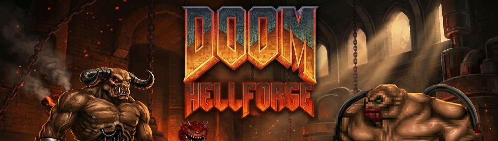

# DOOM: HELLFORGE

DOOM: HELLFORGE is a personal Windows fork of the classic DOOM source, built
from the DERP/Duct-Tape renderer and the Tuin-Doom-Enhanced source fork. It
keeps classic gameplay compatibility while adding a modern native renderer,
destruction, lighting, Fluid Weapons/FluidMonsters support, diagnostics, and
single-player combat presentation features.

**[Build instructions](BUILDING.md)** · **[Documentation index](docs/README.md)** · **[Change history](docs/changes)**



## Download and play

1. Build or obtain `DOOM-Hellforge.exe`.
2. Launch it and select a compatible Doom, Doom II, Final Doom, or Freedoom IWAD.
3. Add compatible WAD/PK3 add-ons in load order, then choose **PLAY GAME**.
4. Use **F4** for graphics, lighting, combat, bundled-mod, and accessibility settings.

Commercial IWADs are not included. Windows x64, a Vulkan-capable graphics
driver, and .NET Framework 4.5+ are required for the supplied launcher.

The launcher stores this fork's profile, backups, crash logs, screenshots, and
lighting cache under `%LOCALAPPDATA%\\DOOM-HellforgeLauncher`; game graphics
settings use `%APPDATA%\\Local Games\\DOOM Hellforge`.

## Current features

### Renderer, lighting, and world presentation

- Native SDL3 accelerated 3D renderer with dynamic lights, colored materials,
  reflections, liquid surfaces, sky lighting, shadows, AO, caustics, and
  destruction geometry.
- Multithreaded lighting bake, spatial ray traversal, selective relighting,
  reusable geometry, and bounded light/shadow caches.
- Persistent map-lighting cache keyed by resource content, map inputs, world
  state, lighting settings, and bake format. F4 controls caching; the launcher
  can clear it. GPU handles, pointers, actors, blood, particles, and live
  effects are never serialized.
- Safe level-transition teardown, worker barriers, first-frame diagnostics,
  crash logs, retained PDB symbols, and Windows minidumps.
- Large-texture and large-WAD compatibility improvements, including expanded
  texture column offsets and configurable native zone memory.

### Weapons and bundled content

- Native Fluid Weapons presentation for fists, pistol, shotgun, super shotgun,
  chaingun, rocket launcher, plasma rifle, BFG, and chainsaw.
- Recoil, reload and support hands, shell/bullet catches, muzzle flashes,
  plasma/BFG effects, weapon fidgets, smooth display interpolation, widescreen
  framing, fist alternation, weapon wheel, and optional fast-pistol behavior.
- Bundled Fluid Weapons, Fluid Weapons SFX, and FluidMonsters packages can be
  enabled independently through F4. Their original notices and credits remain.

### Monsters and combat

- Optional sprite-pixel critical parts with transparent-pixel misses and
  human headshots.
- Extended monster weak points and weapon vulnerabilities for humanoids,
  floating monsters, Lost Souls, Pinky/Spectre faces, and mechanical brain/leg
  regions, with explicit single-player sprite-only exclusions.
- Headshot impact feedback, metal-leg sparks, progressive bleeding, temporary
  injuries, localized effects, and optional monster frenzy/infighting rules.
- Native FluidMonsters movement for supported ground monsters, overlap recovery,
  door/corner chase fixes, floor/ceiling fitting, and typed notarget controls.

### HUD, input, and game flow

- Classic, compact modern, and tactical HUD layouts with scale and placement
  controls, widescreen anchoring, kills/secrets/items counters, notices, Toasty
  presentation, photo mode, camera director, arcade scoring, and LAN/co-op.
- Local single-player movement options including autorun, jumping, mouse look,
  and limited air steering. Demo, multiplayer, voxel, and unsupported scripted
  content retain their documented restrictions.
- F4 settings persist only when applied through the normal close/apply flow;
  F10 discards unapplied drafts. Settings export/import creates recovery backups.

## Compatibility and limitations

The supported map target is classic DOOM/Boom-style WAD content. This fork does
not implement a general GZDoom ZScript/DECORATE/UDMF runtime, arbitrary custom
shaders, or full voxel-mod scripting. Native voxel rendering does not provide
sprite-specific anatomy or deformation. Multiplayer, demos, and several
renderer-only features intentionally bypass single-player sprite combat rules.

Performance depends on map complexity, hardware, resolution, lighting settings,
and accumulated destruction. The lighting cache reduces repeated bake work but
does not avoid map reconstruction, geometry preparation, or GPU uploads.

See the [large-WAD compatibility report](docs/changes/BIG-WAD-COMPATIBILITY.md)
and [reload/cache report](docs/changes/RELOAD-LIGHTING-CACHE.md) for measured
limits and verification evidence.

## Building

Install Visual Studio 2022 C++ Build Tools, CMake, and the Windows SDK, then run:

```powershell
powershell -ExecutionPolicy Bypass -File launcher/build.ps1
```

The default output is `dist/DOOM-Hellforge.exe`. Native tests and optional GPU
checks are documented in [BUILDING.md](BUILDING.md). No commercial IWAD is
bundled with the source or launcher.

## Source and credits

- [DERP / original engine project](https://github.com/robongrui/derp)
- [Tuin-Doom-Enhanced source fork](https://github.com/tuin-boop/Tuin-Doom-Enhanced)
- DOOM source by id Software; original notices are retained.
- MR's Fluid Weapons, Fluid Weapons SFX, FluidMonsters, SDL3, Nuked OPL3,
  TinySoundFont, Toasty media, and other dependencies retain their own credits
  and licenses.

See [LICENSE](LICENSE), [licenses/NOTICE.txt](licenses/NOTICE.txt), and
[licenses/THIRD_PARTY.md](licenses/THIRD_PARTY.md).

## Project status

This fork is actively reorganizing its release and documentation identity.
Historical reports retain their original build names and dates for traceability;
current feature documents carry an explicit HELLFORGE build/time metadata block.
